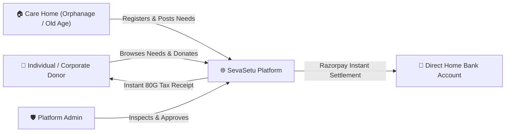
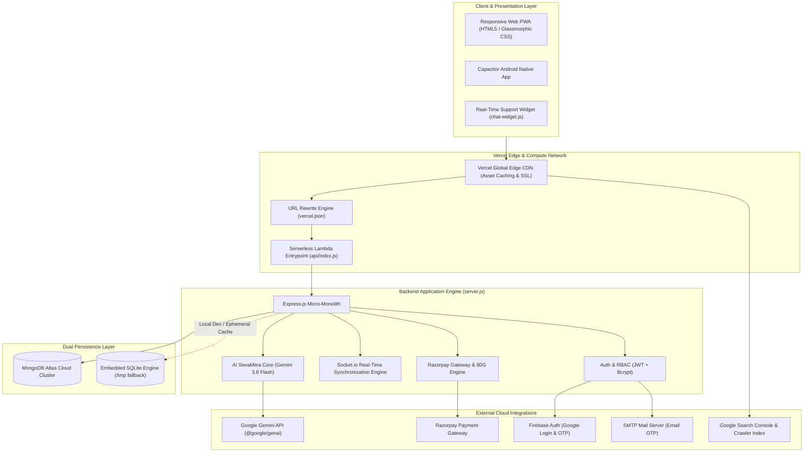
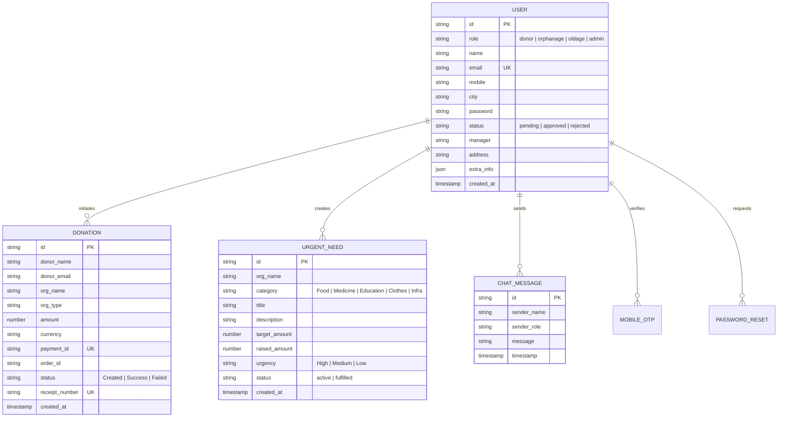
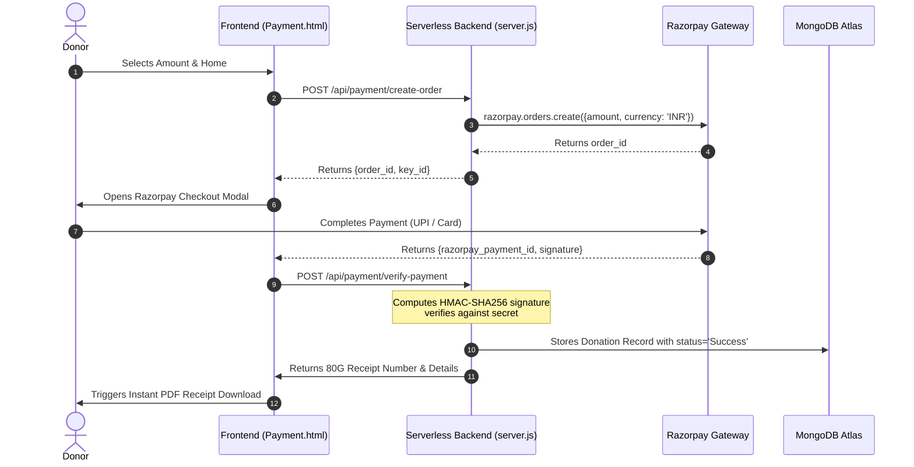
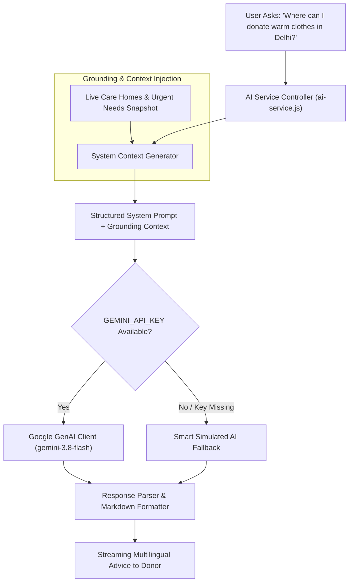

# SevaSetu: Case Study & System Architecture

> **A Digital Bridge Between Care and Need**  
> Direct, Transparent, and Impactful Philanthropy Connecting Donors with Verified Orphanages & Old-Age Homes.

---

## 1. Executive Summary & Problem Space

### 1.1 The Philanthropic Trust Gap in India
India is home to thousands of registered and unregistered child-care institutions (orphanages) and elder-care facilities (old-age homes). While individual donors and corporate sponsors express high willingness to donate, philanthropy faces severe friction:

1. **Middlemen & Administrative Leakage**: Traditional charitable donation pipelines often lose 15% to 35% of funds to administrative overhead, aggregators, and marketing intermediaries.
2. **Trust Deficit & Ghost Facilities**: Donors hesitate to contribute monetary funds due to concerns over legitimacy, shell NGOs, and lack of real-time utilization visibility.
3. **Mismatched In-Kind Giving**: Care homes frequently receive surplus supplies of non-perishables while facing acute, unaddressed shortages of medicines, infant formula, bedding, or specialized elder care items.
4. **Frictional Giving Experience**: Missing instant 80G tax exemption certificates, complex onboarding forms, and lack of mobile accessibility discourage modern, digital-first donors.

### 1.2 The SevaSetu Mission
**SevaSetu** solves this systemic mismatch by operating as an open, zero-middleman digital platform. It directly connects verified grassroots care homes with donors, providing:
- Direct bank-to-home payment routing via Razorpay.
- Real-time urgent needs matching (ration, medical aid, infrastructure).
- Automated 80G tax deduction receipts.
- A strict two-tier Admin Verification gate preventing unverified institutions from receiving public funds.
- An AI-powered donation assistant (**SevaMitra**) grounded in live facility data.

---

## 2. Product Case Study

### 2.1 User Personas & Core Journeys



#### Persona A: The Transparent Giver (Donor)
- **Profile**: Working professional seeking genuine, direct social impact with verifiable tax benefits.
- **Pain Point**: Wants to know exactly which shelter home receives the funds and needs an immediate 80G tax slip.
- **Journey**:
  1. Accesses SevaSetu via web or native Android app.
  2. Authenticates via 1-Click Google Sign-In or Mobile OTP.
  3. Filters verified homes by city and urgency (e.g., medical emergency in Lucknow).
  4. Completes donation via UPI/Cards using Razorpay Checkout.
  5. Instantly downloads PDF 80G tax receipt and monitors live fulfillment status.

#### Persona B: The Care Home Administrator
- **Profile**: Caretaker at a non-profit orphanage or senior citizen sanctuary.
- **Pain Point**: Struggles with irregular funding cycles, manual bookkeeping, and lack of digital visibility.
- **Journey**:
  1. Submits organizational registration with legal registration number, manager ID, and address.
  2. Enters status `pending` until verified by SevaSetu safety admins.
  3. Once approved, logs into dedicated dashboard (`/Dashboard00.html` or `/orphanage.html`).
  4. Posts real-time urgent needs (e.g., *"15 Blankets & Insulin Supplies - ₹12,000 required"*).
  5. Receives instant WebSocket notifications upon donation receipt.

#### Persona C: Platform Compliance Officer (Admin)
- **Profile**: Security & NGO compliance auditor.
- **Pain Point**: Preventing fraudulent listings without stalling genuine grassroot sanctuaries.
- **Journey**:
  1. Logs into protected `/admin.html` portal via secure admin credentials.
  2. Inspects pending applications, legal entity documentation, and contact details.
  3. Approves or rejects organizations with one click, triggering real-time state synchronization across the platform.

---

## 3. High-Level System Architecture

SevaSetu is designed around a **Cloud-Native, Serverless Micro-Monolith** paradigm, allowing zero-cost idle operation on Vercel while scaling elastically on demand.



---

## 4. Subsystem Deep-Dive

### 4.1 Hybrid Data Persistence Architecture

SevaSetu adopts a dual-persistence strategy to handle both serverless container statelessness and frictionless local development.



1. **Production Cluster (MongoDB Atlas via Mongoose)**:
   - Primary database for multi-region deployment.
   - Schemas enforce data integrity for Users, Organizations, Donations, Urgent Needs, and Audit logs.
   - Resilient connection management handles serverless container sleep/wake cycles with auto-reconnect.

2. **Serverless Ephemeral Storage (Embedded SQLite)**:
   - Utilizes Node.js native `DatabaseSync` (`node:sqlite`).
   - Dynamically checks `Boolean(process.env.VERCEL || process.env.AWS_LAMBDA_FUNCTION_NAME)`.
   - On Vercel, redirects database path to `path.join(os.tmpdir(), 'sevasetu.db')` to prevent `EROFS: Read-only file system` errors during ephemeral lambda executions.

---

### 4.2 Security & Financial Integrity



- **HMAC-SHA256 Signature Verification**: Eliminates transaction tampering. No donation is marked `Success` unless verified using cryptographic signatures generated with `RAZORPAY_KEY_SECRET`.
- **JWT RBAC Authentication**: Roles (`donor`, `orphanage`, `oldage`, `admin`) are encoded in cryptographically signed JWT tokens with expiration policies.
- **Admin Verification Gate**: All newly registered care institutions are blocked from fundraising listings until verified by a system administrator.

---

### 4.3 AI Integration: SevaMitra (Google Gemini 3.8 Flash)

SevaSetu integrates Google's latest `gemini-3.8-flash` model using `@google/genai` to assist users across languages and queries.



- **Live Database Grounding**: The prompt dynamically injects the top active urgent needs and verified institutions so answers are grounded in real operational data rather than generic hallucinations.
- **Smart Simulated Fallback**: In the absence of an API key or during network downtime, SevaSetu automatically transitions to an intelligent rule-based knowledge engine, ensuring 100% uptime for end users.

---

## 5. Deployment Topology & Performance

```text
Global Internet Traffic
         │
         ▼
┌────────────────────────────────────────────────────────┐
│ Vercel Anycast Edge Network (CDN)                      │
│ - SSL Termination & DDoS Protection                    │
│ - Automatic Gzip & Brotli Compression                  │
│ - Static Asset Edge Caching (CSS, JS, Images, Icons)   │
└────────────────────────────────────────────────────────┘
         │
         ├───► Static Files Route (/Homepage.html, /Role.html, etc.)
         │
         ▼
┌────────────────────────────────────────────────────────┐
│ Vercel Serverless Function (api/index.js)              │
│ - Node.js 22.x Fluid Compute Runtime                   │
│ - Dynamic Request Path Restoration                     │
│ - Express App Handler Proxy                            │
└────────────────────────────────────────────────────────┘
         │
         ├───► REST APIs (/api/auth/*, /api/payment/*, /api/stats)
         ├───► SEO Endpoints (/sitemap.xml, /robots.txt)
         └───► Database Driver Pooling (MongoDB Atlas Cloud M0/M10)
```

### 5.1 Key Configuration Files
1. **`vercel.json`**:
   - Bundles all HTML templates and media into serverless lambda contexts via `includeFiles`.
   - Routes `/api/(.*)` to serverless compute.
   - Catches extensionless web routes (e.g., `/Role` $\rightarrow$ `Role.html`).
2. **`robots.txt` & `sitemap.xml`**:
   - Fully optimized for Google Search Console with priority ratings for core conversion landing pages.

---

## 6. Scalability & Technical Roadmap

| Phase | Milestone | Objective |
|---|---|---|
| **Phase 1 (Complete)** | **Serverless Migration & Cloud DB** | Replaced long-running Render containers with Vercel serverless execution + MongoDB Atlas cloud persistence. |
| **Phase 2 (Current)** | **Search Indexing & Discoverability** | Google Search Console verified, XML sitemaps crawled, and canonical domain bindings active. |
| **Phase 3 (Next)** | **Automated Gov Verification API** | Integrate NGO Darpan & UIDAI verification APIs for automated KYC validation of care homes. |
| **Phase 4** | **Hyperlocal Geofencing & Logistics** | Coordinate local volunteer pickups for surplus food and in-kind physical donations. |
| **Phase 5** | **On-Chain Micro-Audits** | Public cryptographic ledger recording supply deliveries against donation receipts. |

---

## 7. Conclusion
SevaSetu bridges technology and social empathy. By eliminating intermediary fees through modern serverless web architectures, enforcing cryptographic transparency in payments, and lowering onboarding barriers with Google AI and Firebase authentication, SevaSetu demonstrates how modern full-stack web engineering can build trust and direct impact in humanitarian philanthropy.
